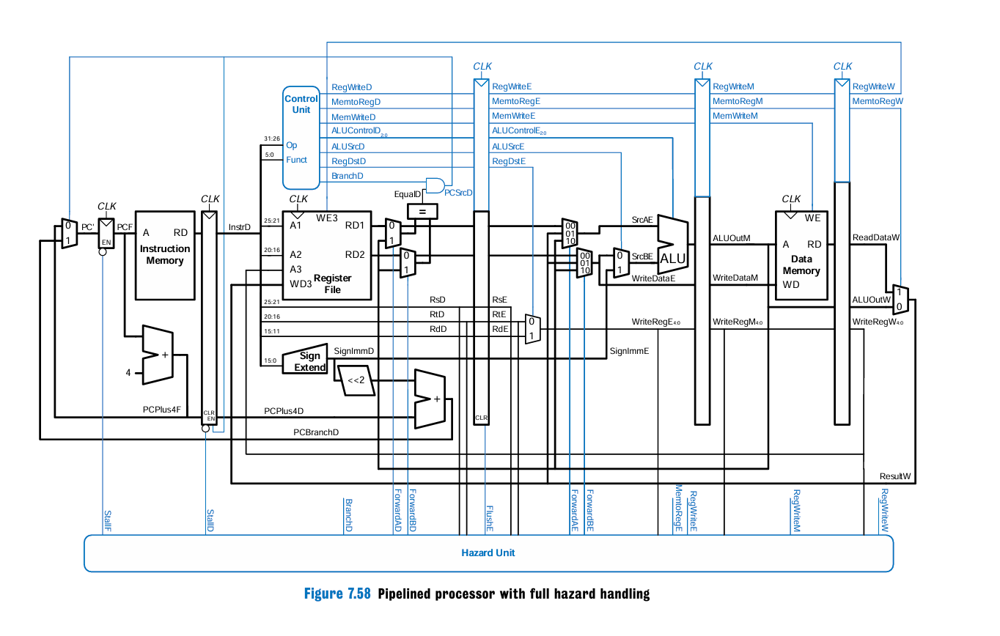
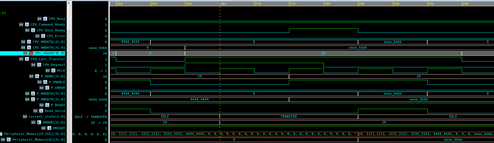
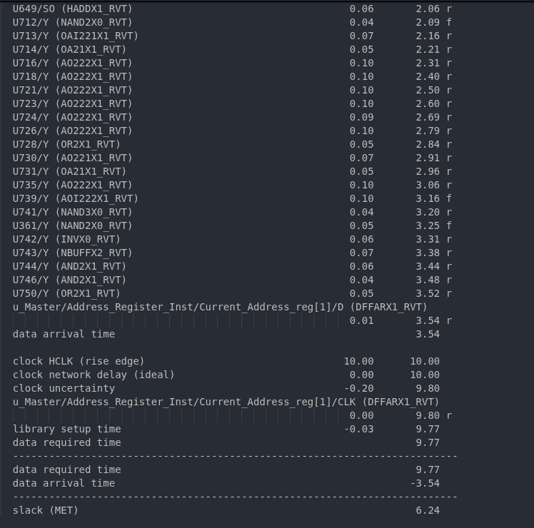
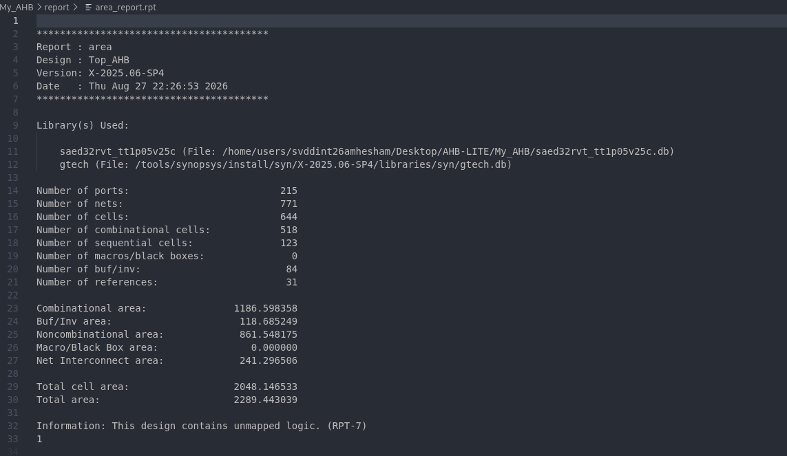
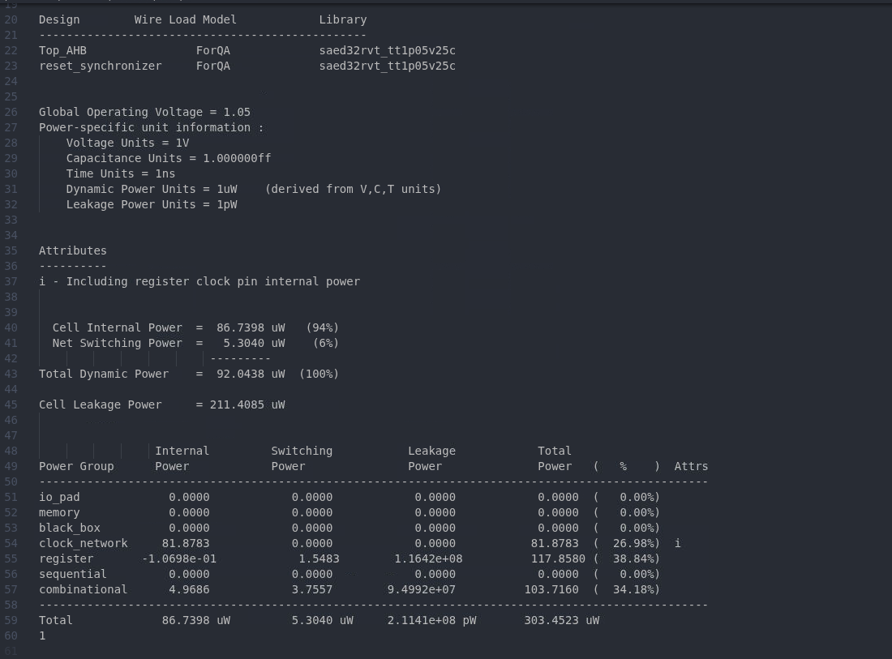

# AMBA AHB-Lite Master/Slave IP & Pipelined MIPS SoC Integration 🚀


-purple.svg)


## 📌 Overview
This repository contains the complete RTL design, verification, synthesis, and SoC integration of an **AMBA 3 AHB-Lite bus system**. It is built in two stages:

1. **`My_AHB`** – A standalone, reusable **AHB-Lite Master IP** and **AHB-Lite Slave**, verified with directed testbenches and synthesized with Synopsys Design Compiler at **100 MHz**.
2. **`Integration_System`** – A full **SoC** where a **5-stage pipelined MIPS processor** drives the AHB-Lite Master, which talks to two slaves through an address decoder and read-data multiplexer:
   - **Slave 1 – On-chip RAM** (1 KB, `0x0000_0000 – 0x0000_03FF`)
   - **Slave 2 – UART peripheral** (`0x0000_0400` and above), running on an **independent 16 MHz clock domain** and connected through an **asynchronous FIFO** with Gray-code pointer synchronization.

---

## 🏗️ SoC Architecture
<p align="center">
  
</p>

| Domain | Clock | Blocks |
|---|---|---|
| CPU / Bus | 100 MHz (`HCLK`) | Pipelined MIPS, AHB Master, Decoder, MUX, RAM Slave, UART Slave interface (write side) |
| Peripheral | 16 MHz (`UART_clk`) | UART TX/RX, Async FIFO read side |

---

## ✨ Key Features

### AHB-Lite Master IP
* Fully conforms to the **AMBA 3 AHB-Lite** specification (`HTRANS` IDLE / BUSY / NONSEQ / SEQ).
* Supports **SINGLE** and **INCR / INCR4 / INCR8 / INCR16 / WRAP4 / WRAP8 / WRAP16** bursts with a dedicated burst counter and address generator.
* **Pipelined address and data phases** – zero-latency back-to-back transfers using a data-phase alignment register (`Write_Data_Register`, `Capture_Register`).
* **Wait-state handling** through `HREADY` without data loss, plus **master-side BUSY** insertion when the CPU is not ready.
* **Error handling** – two-cycle `HRESP` ERROR response terminates the burst and flags `CPU_Error`.
* **Timeout watchdog** – aborts a transfer if the slave holds `HREADY` low for 15 cycles.
* Simple 3-state FSM controller: `IDLE → TRANSFER ⇄ BUSY`.

### AHB-Lite Slaves
* **RAM slave** – synchronous memory with configurable depth, optional address/data-out pipelining, and optional parity.
* **UART slave** – bridges AHB writes into an async FIFO feeding a UART transmitter, with handshake back for reads.
* Error-response generator and reset synchronizers on every clock domain.

### Pipelined MIPS Processor
* Classic **5-stage pipeline** (IF / ID / EX / MEM / WB).
* **Hazard detection unit** with **data forwarding** and stall/flush support, early branch resolution.
* **Single-precision floating-point unit** (`add.s`, `sub.s`) – unpacker, alignment, ALU, normalizer and packer stages with a separate FP register file.
* Memory accesses (`lw` / `sw`) are converted to AHB-Lite transactions through a CPU-to-Master interface.

### Clock Domain Crossing
* **Asynchronous FIFO** (128 × 8) with binary-to-Gray pointer conversion and two-flop synchronizers.
* Level-to-pulse converters and double-flop synchronizers for control handshakes.
* Verified with **SpyGlass CDC**.

---

## 🗂️ Repository Structure
```
AHB-Lite-Protocol/
├── My_AHB/                         # Standalone AHB-Lite Master/Slave IP
│   ├── RTL_Master/                 # FSM, address generator/register, burst counter, timeout, data registers
│   ├── RTL_Slave/                  # AHB slave memory + error response
│   ├── RTL_Top_Module/             # Top_AHB + reset synchronizer
│   ├── TestBench_Top/              # Master–Slave directed testbench
│   ├── filelist.f, Makefile        # VCS / Verdi flow
│   ├── run_synth.tcl, constrain.tcl# Design Compiler synthesis (SAED32, 100 MHz)
│   └── constraints.sgdc            # SpyGlass constraints
│
├── Integration_System/             # Full SoC
│   ├── Pipeline_MIPS/              # 5-stage MIPS + FPU, program.txt / asembly.asm
│   ├── CPU_Master_Interface/       # MIPS ↔ AHB Master glue
│   ├── RTL_Master/                 # AHB Master IP
│   ├── RTL_Slave/                  # Generic slave wrapper (decoder, registers, response handler)
│   ├── Memory_Slave/               # RAM slave (mem.dat initial contents)
│   ├── UART_Slave_Interface/       # AHB ↔ UART bridge + synchronizers
│   ├── UART_IP/                    # UART TX / RX
│   ├── Async_FIFO/                 # Gray-code async FIFO
│   ├── Top_Integration_System/     # Top, address decoder, read-data MUX
│   ├── Top_Integration_System_tb/  # System-level testbench
│   └── filelist.f, Makefile
│
├── photoes/                        # Block diagrams, FSM, waveforms, synthesis reports
└── spec&presentation/              # AMBA AHB-Lite spec (IHI0033A), slides, project documentation
```

---

## 🔧 AHB Master Design

### Block Diagram
<p align="center">
  
</p>

### Finite State Machine
<p align="center">
  
</p>

### MIPS Pipeline
<p align="center">
  
</p>

---

## 📊 Simulation Waveforms

### Single Read & Write
<p align="center"></p>

### Back-to-Back Write → Read
<p align="center"></p>

### Back-to-Back Transfers with 2-Cycle Wait States
<p align="center"></p>

### INCR4 Burst Read & Write
<p align="center"></p>

### INCR4 Burst with Error Response
<p align="center"></p>

---

## 🧪 System Test Program
The MIPS runs `Integration_System/Pipeline_MIPS/program.txt` (source in `asembly.asm`), which exercises both slaves:

```asm
addi $t0, $zero, 0x0000     # RAM base
sw   $t1, 0($t0)            # write to RAM  -> HSEL_1
sw   $t2, 4($t0)
addi $t3, $zero, 0x0400     # UART base
sw   $t1, 4($t3)            # write to UART -> HSEL_2 -> Async FIFO -> UART TX
sw   $t2, 4($t3)
```

---

## 🛠️ Synthesis Results (Top_AHB – Synopsys Design Compiler, SAED32 RVT, TT 1.05 V 25 °C)

| Metric | Result |
|---|---|
| Target clock | **100 MHz** (10 ns period, 0.2 ns uncertainty) |
| Worst setup slack | **+6.24 ns (MET)** |
| Total cell area | **2048 µm²** (518 comb. / 123 seq. cells) |
| Total power | **≈ 303 µW** (92 µW dynamic + 211 µW leakage) |

<details>
<summary>📄 Show synthesis reports</summary>
<p align="center"></p>
<p align="center"></p>
<p align="center"></p>
</details>

### SpyGlass Lint & CDC
<p align="center"></p>

---

## ▶️ How to Run

**Requirements:** Synopsys VCS, Verdi, Design Compiler, SpyGlass.

Standalone AHB Master/Slave:
```bash
cd My_AHB
make run        # compile & simulate with VCS
make verdi      # open waveforms (waves.fsdb)
```

Full SoC (MIPS + AHB + RAM + UART):
```bash
cd Integration_System
make run        # compile & simulate
make verdi      # open waveforms (system.fsdb)
```

Synthesis:
```bash
cd My_AHB
dc_shell -f run_synth.tcl   # reports written to ./report
```

---

## 📚 References
* ARM **AMBA 3 AHB-Lite Protocol Specification** (IHI 0033A) – included in `spec&presentation/`.

---

## 👨‍💻 Author
**Amr Soliman** – *ASIC / FPGA Design & Verification*
[LinkedIn](https://www.linkedin.com/in/amr-soliman19) · [Email](mailto:amrsoliman916@gmail.com)
