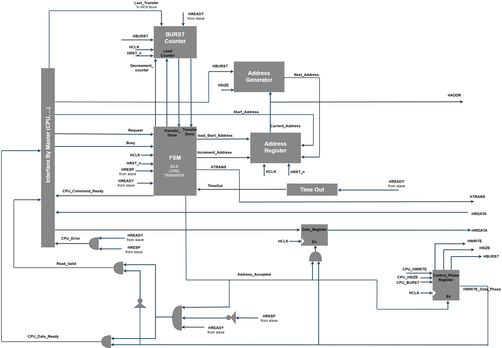
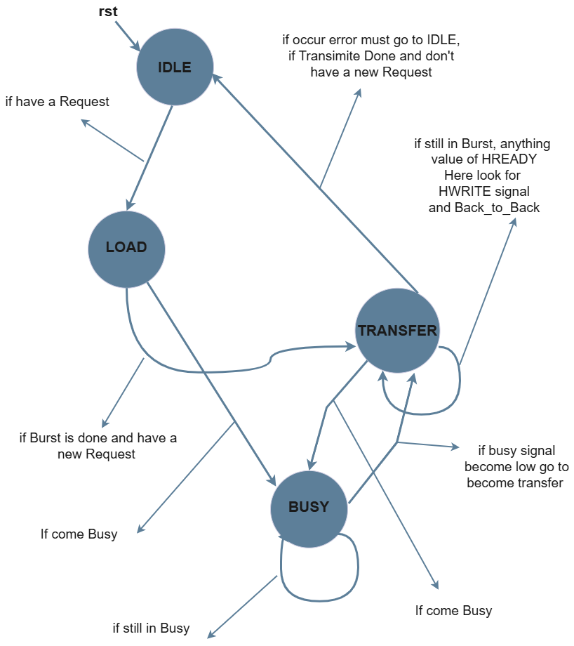
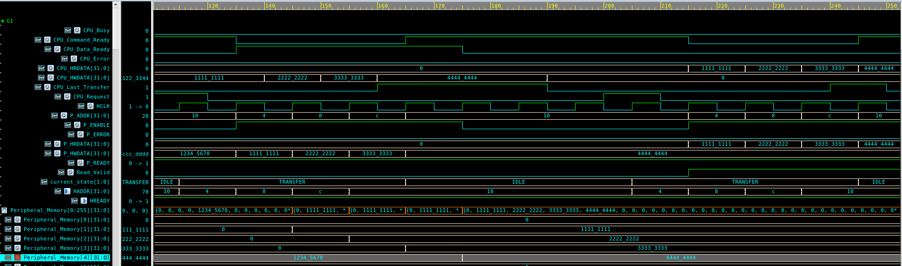
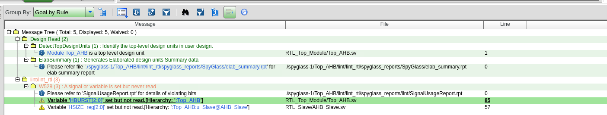

# AMBA AHB-Lite Master/Slave IP & Pipelined MIPS Integration 🚀

## 📌 Overview
This repository contains the complete RTL design, verification environment, and SoC integration for an **AMBA 3 AHB-Lite Bus Architecture**, featuring a custom high-performance **AHB Master/Slave IP**, a 5-stage pipelined **MIPS Processor**, and a **UART Subsystem** operating across asynchronous clock domains.

---

## 🗂️ Repository Structure
* **`My_AHB/`** $\rightarrow$ Contains all AHB Design components, Master IP, Slave memory models, and standalone verification files.
* **`Integration_System/`** $\rightarrow$ Houses the top-level SoC integration combining the Pipelined MIPS Processor, AHB bus infrastructure, and UART peripheral working on an independent clock domain.
* **`photoes/`** $\rightarrow$ Contains architecture diagrams, FSM charts, and verification waveforms.

---

## ✨ Key Features & Architecture
* **Protocol Compliance:** Fully conforms to the AMBA 3 AHB-Lite specification.
* **Pipelined MIPS Core:** A custom 5-stage pipelined MIPS processor featuring data forwarding, hazard detection unit, and single-precision floating-point support (add.s, sub.s).
* **Asynchronous Clock Domain Integration:** Integrates peripherals like UART operating on an independent clock domain relative to the main AHB-Lite bus domain.
* **Zero-Latency Pipelining:** Back-to-Back (B2B) transactions with optimal overlapping of Address and Data phases via a dedicated Data Alignment Register wrapper.
* **Stall Handling:** Dynamic wait-state injection handling via the `HREADY` signal without data loss.

---

## 🏗️ Hardware Architecture & Design

### AHB Master Block Diagram

  

### Master Finite State Machine (FSM)

  

---

## 📊 Simulation & Waveforms

### 1. Back-to-Back Transfers with Wait States

  

### 2. Burst Error Injection & Recovery

  

### 3. INCR4 Zero-Latency Burst

  

---

## 🛠️ EDA Tooling & Sign-off
* **Simulation:** Verified using industry-standard simulators (Synopsys VCS / Verdi FSDB).
* **Static Analysis:** Processed through **Synopsys SpyGlass** for rigorous structural Linting and Clock Domain Crossing (CDC) verification.

  

---

## 👨‍💻 Author
**Amr Soliman** *ASIC/FPGA Design & Verification* [LinkedIn Profile](https://www.linkedin.com/in/amr-soliman19) | [Email](mailto:amrsoliman916@gmail.com)